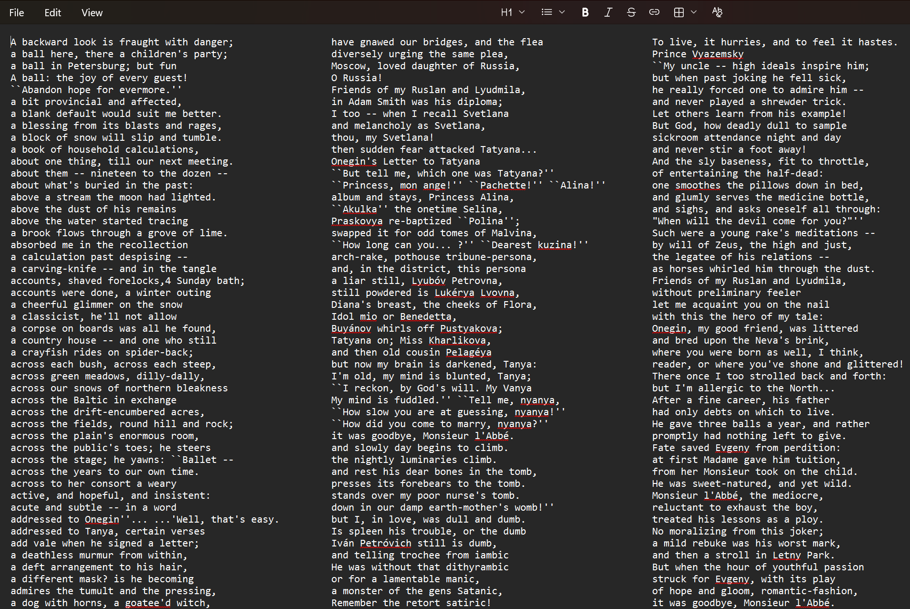

<<h2 align="center"> SortLines </h2>

---

#### table of contents

* [overview](#overview)
* [features](#features)
* [demonstration](#demonstration)
* [option management](#usage)
* [used tools](#libraries)
* [to do](#todo)

---

#### overview

This program is designed to sort lines from an input file in two ways: alphabetically comparing from the first letter and alphabetically comparing from the last letter.Print both results of sorting and original.

---

#### features

* User can select the input and output files
* The output is displayed in three left-aligned columns. The distance between columns is calculated based on the longest line.
* The sort function accepts a partition function as a parameter.

---

#### demonstration

* __output file__
The input text is duplicated in the third column

---

#### option management

__launch__
User has to compile "___main.c___" by __c++__ compiler and run resulting file to launch the program.

__program options__
* Change the value of the macro ___TEXT_FILE_NAME___ to select the input file.
* Change the value of the macro ___OUTPUT_FILE_NAME___ to select the output file.

---

#### used tools

__libraries__
The following __C/C++__ libraries were used in the program

* __stdio.h__
for basic functions (_printf_, etc.)
* __stdlib.h__
for basic functions (_calloc_)
* __assert.h__
for debug (_assert_)
* __sys/stat.h__
for getting information about a file (_stat_)
* __fcntl.h__
for work with files (_open_, etc.)
* __ctype.h__
for work with symbols (_isalpha_, etc.)

---

#### to do

* Output in HTML page format
* Output settings flags
